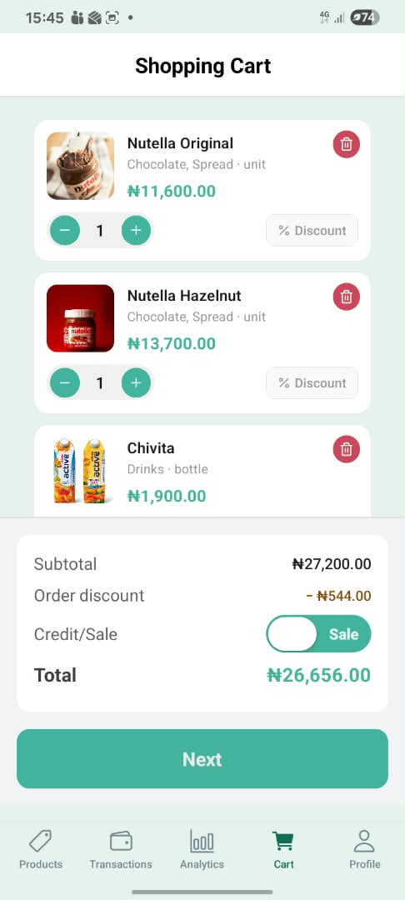
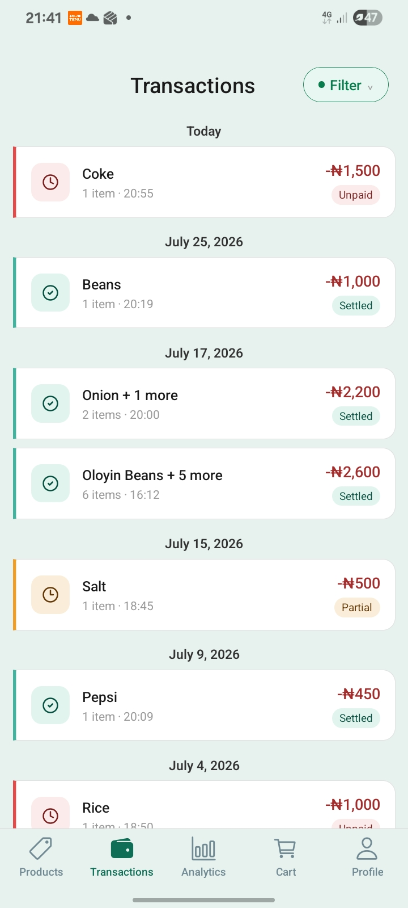
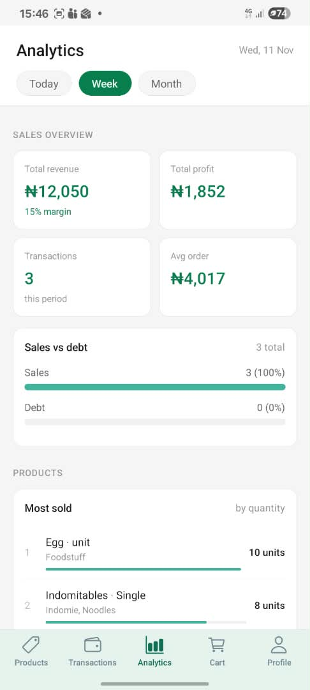
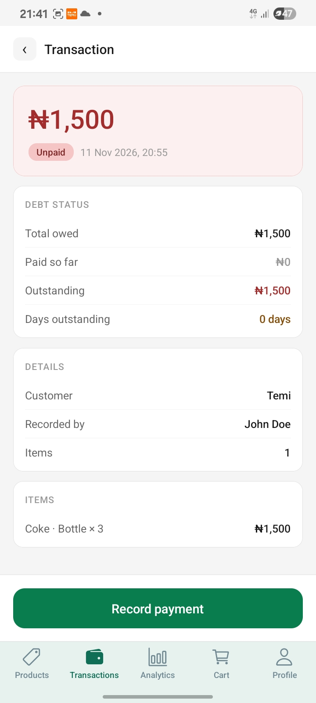
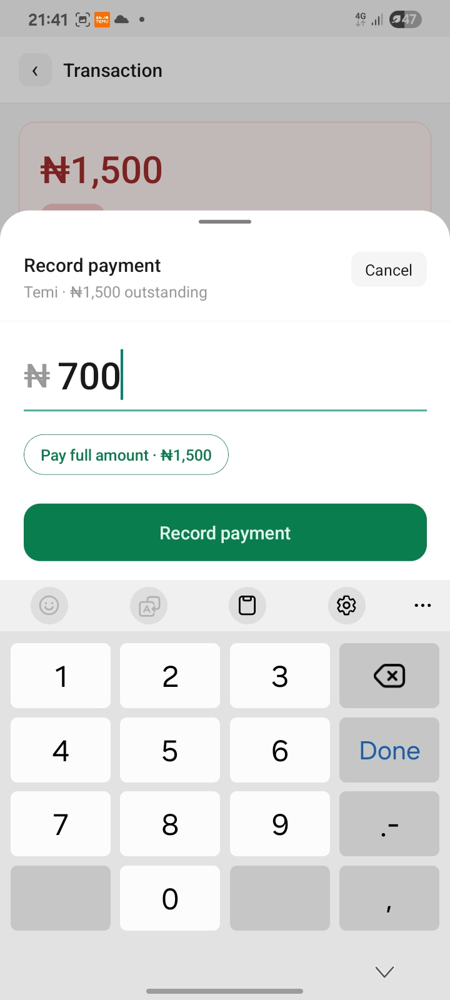
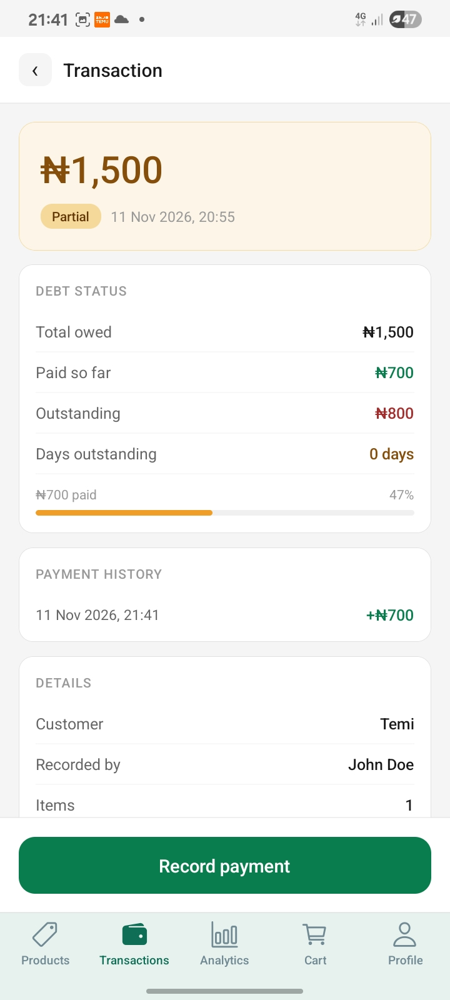
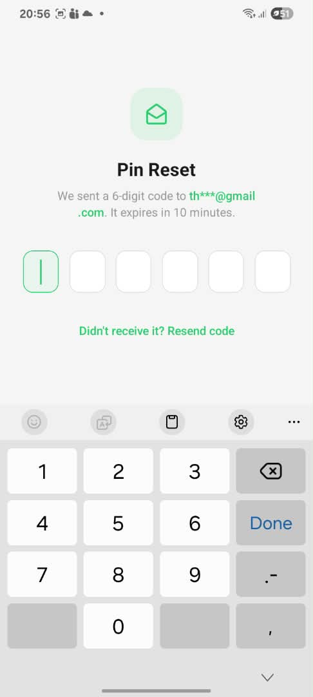
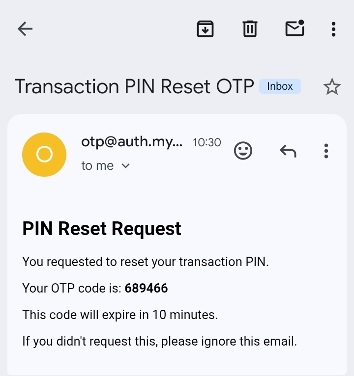
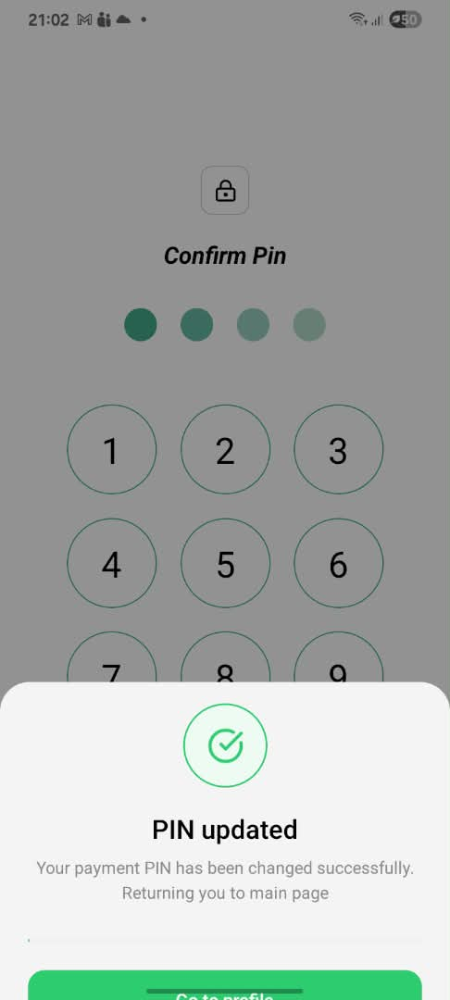
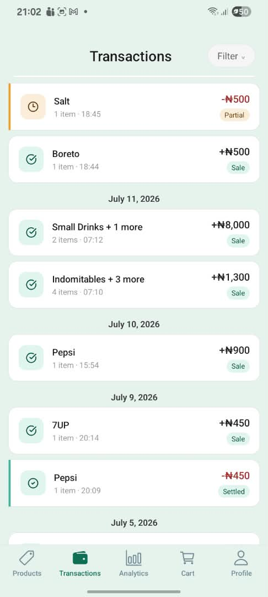

# Trackify

A point-of-sale mobile app I built for my mom's shop. It digitises the product catalogue, records cash and credit sales, tracks what each customer owes, and shows which products sell best.

**Status:** MVP for internal use, in daily use since July 2026. It is not packaged for public deployment: the backend is a private Supabase project and signups are disabled on my instance. See [Known limitations](#known-limitations).

|   |   |   |
|---|---|---|
|  |  |  |

## Why I built it

My mum needed to move her product list and sales records off paper: record sales and credit sales, see which products perform, and track what each customer owes. I started from the Net Ninja's Appwrite + React Native tutorial, then migrated to Supabase. It is the project I am proudest of because it is the one I actually use.

It is a raw MVP. Some screens are plain and a few network failures are unhandled, but it does the job. The only essential feature I left out is offline mode, because the shop is always online.

## Features

- **Products:** add, edit and deactivate products, with sizes and thumbnails
- **Checkout:** sale or credit sale, item-level and order-level discounts. The discounted price is stored next to the original so history stays accurate
- **Customers:** search, add on the fly, or sell anonymously
- **Debt tracking:** filter transactions by debt, open one, record a full or partial payment
- **Analytics:** best-performing and most-sold products, sales vs debt, top customer
- **Security:** email + password login, a PIN for authorizing transactions, and forgot-password / forgot-PIN through a custom OTP flow

## Walkthroughs

### 1. Record a sale with a discount
|   |
|---|
|  | 

Order-level discount enabled


### 2. Credit sale, then settle the debt
|   |   |   |   | 
|---|---|---|---|
|  |  |  |  | 

Filter transactions by debt, open one, and record a full or partial payment.

### 3. Forgot PIN (custom OTP)
|   |   |   |
|---|---|---|
|  |  |  |

The code arrives by email, then the user sets a new PIN.

### 4. Analytics and transaction history
|   |   |
|---|---|
|  |  |

Best-performing and most-sold products, sales vs debt, and a filterable history.

Screenshots use sample data, with personal details blurred.

## Tech stack

| Layer | Choice |
|---|---|
| Mobile | React Native, Expo, Expo Router, JavaScript |
| State | React Context, React Hooks|
| Backend | Supabase: Postgres, Auth, Row Level Security, Edge Functions (Deno) |
| Email | Resend, with a custom sending domain |
| Builds | EAS Build |
| Monitoring | Sentry (error reporting) |

## Project structure

Both the repository root and the app folder are named `trackify` for historical reasons (I moved git to the root to include Supabase and the edge functions).

```
trackify/                       repo root
├── trackify/                   Expo app (JavaScript)
│   ├── app/                    Screens (Expo Router): (auth), (dashboard), onboarding,
│   │                           password-reset, pin-reset
│   ├── src/
│   │   ├── api/                Supabase calls, one file per resource
│   │   ├── services/           Business logic: cart, transactions, analytics, OTP, onboarding
│   │   ├── hooks/, contexts/   Data hooks and shared state
│   │   ├── components/         UI grouped by feature
│   │   └── utils/              Validation, formatters, token storage, error mapping
│   ├── eas.json
│   └── app.config.js
├── supabase/
│   ├── functions/              Edge functions (Deno)
│   │   ├── a-request-otp       Generate and email an OTP
│   │   ├── verify-otp          Check the OTP, issue a short-lived reset token
│   │   ├── reset-password      Set a new password using a reset token
│   │   ├── save-pin            Store a PIN (onboarding, change, or reset)
│   │   └── verify-pin          Check a PIN
│   └── migrations/             Schema, RLS policies, triggers
└── trackify.code-workspace     Multi-root VS Code workspace
```

## Data model highlights

- `products` are distinct items with their own cost basis. `product_variants` are different packaging of the same product (a bottle vs a crate of 12). A different flavour, size or cost means a new product.
- Products and variants are soft-deleted with `is_active`: deactivating one hides it from the catalogue but keeps transaction history intact.
- Tables for planned features (`product_price_history`, `stock_inventory`) exist but the app does not use them yet.

More in [docs/design-notes.md](docs/design-notes.md).

## Authentication and security

### Login, PIN and OTP

- Login is Supabase Auth (email + password).
- **PINs** are never stored directly. `save-pin` hashes them with PBKDF2-SHA256 (600,000 iterations) and a random 16-byte salt, and stores `salt + hash` as base64. `verify-pin` re-derives the hash with the stored salt and compares.
- **OTPs** are random 6-digit codes from `crypto.getRandomValues`. Only the SHA-256 hash is stored, with a 10-minute expiry. Requesting a new code invalidates earlier ones. Each OTP has a `purpose` (password reset or PIN reset) so the two journeys cannot be mixed.
- After a correct OTP, `verify-otp` creates a single-use reset token (10 minutes) tied to the user and the purpose. The app stores it in `expo-secure-store`, keyed by purpose, and presents it at the final step.
- Unknown emails get the same response as known ones, so the endpoint does not reveal which emails are registered.

### Who can change a PIN?

`save-pin` and `verify-pin` take the user from the verified JWT, never from the request body. They use the service-role key, which bypasses RLS, so the checks live in the function itself.

| Situation | What `save-pin` requires |
|---|---|
| First-time PIN (onboarding) | No existing PIN |
| Change PIN | The current PIN, verified on the server |
| Forgot PIN | A valid, unused, unexpired `pin_reset` reset token for that user |


### Threat model

Trackify was built for a small, trusted group (my family). It is **not hardened for public registration or hostile users**. The review below came from reading my own code after that assumption stopped holding: signups were open and new users were given my business.

## Security review

I reviewed my own auth design after building it. These are the findings and what I did about them.

| Finding | Status |
|---|---|
| Open signups gave new users access to my business's data | Fixed: signups disabled |
| `save-pin` / `verify-pin` trusted a `userId` from the request body | Fixed: identity comes from the verified JWT |
| Changing a PIN was enforced by screens, not the server | Fixed: server requires the current PIN or a verified reset token |
| Reset tokens were not tied to a purpose on the server | Fixed: `purpose` column, checked by `reset-password` and `save-pin` |
| OTPs and PINs were printed to function logs while debugging | Fixed: removed |
| Users could update their own profile row, including PIN columns, directly | Fixed: database trigger blocks client changes to `pin_hash` and `pin_set_at` |
| Known and unknown emails returned different messages | Fixed: identical response |
| Client token cleanup deleted the wrong keys | Fixed: uses the purpose-keyed clear helper |
| No attempt limits on OTP verification, PIN verification or OTP requests | Documented, not built |
| Business and role are assigned from the client during signup | Documented (safe only because signups are closed) |
| Other items | See [Known limitations](#known-limitations) |

## Key decisions

**Edge functions for OTP and PIN.** OTP generation, the Resend key and the admin client cannot live in the app bundle, so these run server-side.

**Custom OTP instead of Supabase's default recovery.** My first attempt used Supabase's email-link flow. Link-based recovery in a mobile app needs deep linking and an Expo dev build, I ran into limitations and bug reports at the time, and I wanted a code-based flow I could reuse for both password and PIN recovery. The commit history shows the link attempt first, a custom OTP about three weeks later, and a later refactor that unified the password and PIN flows. I did not write my reasoning down, so this is reconstructed from the history.
*Trade-off:* I now own security-sensitive code the platform could mostly handle. In hindsight I would check whether Supabase's email OTP (a code in the email template instead of a link) covers the password flow today. It has no PIN concept, so PIN reset would stay custom.

**Resend with my own domain.** I bought a domain through Hostinger and verified it with Resend (following a tutorial) so OTP emails can reach any user, not just my own address. It is an ongoing yearly cost.

**No offline mode.** The shop is always online, so I cut it to ship sooner.

**Single business.** The app assumes one business. Multi-business onboarding is designed (see Roadmap) but not built.

## Lessons learned

- **Client-side checks are not security.** My Change PIN flow verified the current PIN on the server, but nothing forced the PIN-saving function to depend on it. A direct call skipped the check. The server action itself must verify proof.
- **Never take identity from the request body.** Functions using the service-role key bypass RLS, so they must derive the user from the verified JWT.
- **RLS does not cover what the client can write.** If users can edit their own row, sensitive columns need their own protection.
- **Don't log secrets.** I printed OTPs and PINs while debugging and removed them before publishing.
- **Design to a threat model, and revisit it.** Open signups plus a default business broke my "trusted users" assumption.
- **Own AI-generated code.** I used AI for the crypto helpers and error mapping, then had to study PBKDF2, salting, OTP storage and RFC 9457 to explain and review them.
- **Write decisions down as you make them.** I could not reconstruct why I chose a custom OTP, so I now keep a decisions log.
- **Know who generates what.** I had assumed reset tokens were created in two places. Tracing the flow end to end showed they are created only in `verify-otp`; the app stores and presents them.
- **Consistent API errors matter.** My edge functions and client error mapping use ad hoc responses. RFC 9457 problem details would be cleaner. Not yet adopted.
- **Deno edge-function tooling was a time sink.** Deno setups, import maps and editor support cost me more time than the logic.

## Known limitations

- No attempt limits or lockouts on OTP verification, PIN verification or OTP requests.
- Business and role are assigned from the client during signup. This is safe only because signups are closed; a proper fix is a server-side step or an invite flow.
- `a-request-otp` looks users up with `listUsers`, which is paginated, so it only scales to a small user base.

- OTP use and reset-token creation are not atomic, so two parallel requests could both succeed.
- API error responses are inconsistent across edge functions and the client mapper.
- No offline mode.
- No automated tests and no CI. I verified it manually, which was enough for internal use.

## Roadmap

- **Multi-business onboarding:** after signup, choose Business Owner or Employee. Owners create a business profile and import their catalogue from a CSV/Excel template. Employees join with an invite code from the owner, valid and single-use, which links them to that business on the `employees` table.
- Attempt limits and lockouts (for example 5 failed OTP guesses invalidate the code, 5 failed PIN attempts lock for 15 minutes, per account).
- Hash OTPs with a server-side secret (HMAC).
- RFC 9457-style error responses.
- Offline support.
- Tests and CI.
- Seed data and a one-command local setup.

## Running it yourself

The backend is a private Supabase project, so this repo will not run out of the box. To run your own copy:

1. Create a Supabase project and apply `supabase/migrations`. The schema also contains tables for planned features that the app does not use yet (`product_price_history`, `stock_inventory`).
2. Create a user from the dashboard, then add a business row and an `employees` row for that user. The signup screen assigns a business id from the client, so set that up for your own project (see limitations). There is no seed data yet; add a few products through the app.
3. Deploy the functions: `supabase functions deploy` for each folder. Set the secrets `RESEND_API_KEY`, `MY_SUPABASE_URL` and `MY_SUPABASE_SERVICE_ROLE_KEY`.
4. Create a Resend account and verify a sending domain, then change the `from` address in `a-request-otp` (it currently uses my domain).
5. In `trackify/`, copy `.env.example` to `.env` and set `EXPO_PUBLIC_SUPABASE_URL` and `EXPO_PUBLIC_SUPABASE_ANON_KEY`. `SENTRY_AUTH_TOKEN` is a build-time secret used to upload source maps: keep it out of the repo and set it as an EAS secret. For EAS builds, set the same variables as EAS environment variables.
6. Run the app, either way:
   - **Dev server:** `npm install`, then `npx expo start`.
   - **Preview build:** create your own Expo project (`eas init`, then update `owner` and `extra.eas.projectId` in `app.config.js`), set the `EXPO_PUBLIC_*` variables as EAS environment variables, then run `eas build --profile preview`.

   Sentry is configured for my project, so remove it or add your own DSN.

**Editor note:** open `trackify.code-workspace` (File > Open Workspace from File) so Deno applies only to `supabase/functions`.

## Repository history

This repo is a clean snapshot. The earlier history lives in a private repository because it contained personal data and business details.

## License

Copyright (c) 2026 Oche Jerome. All rights reserved. The source is public for review and portfolio purposes. Please contact me before reusing it.

## Credits

Shop icons from icons8. Started from the Net Ninja's Appwrite + React Native tutorial.